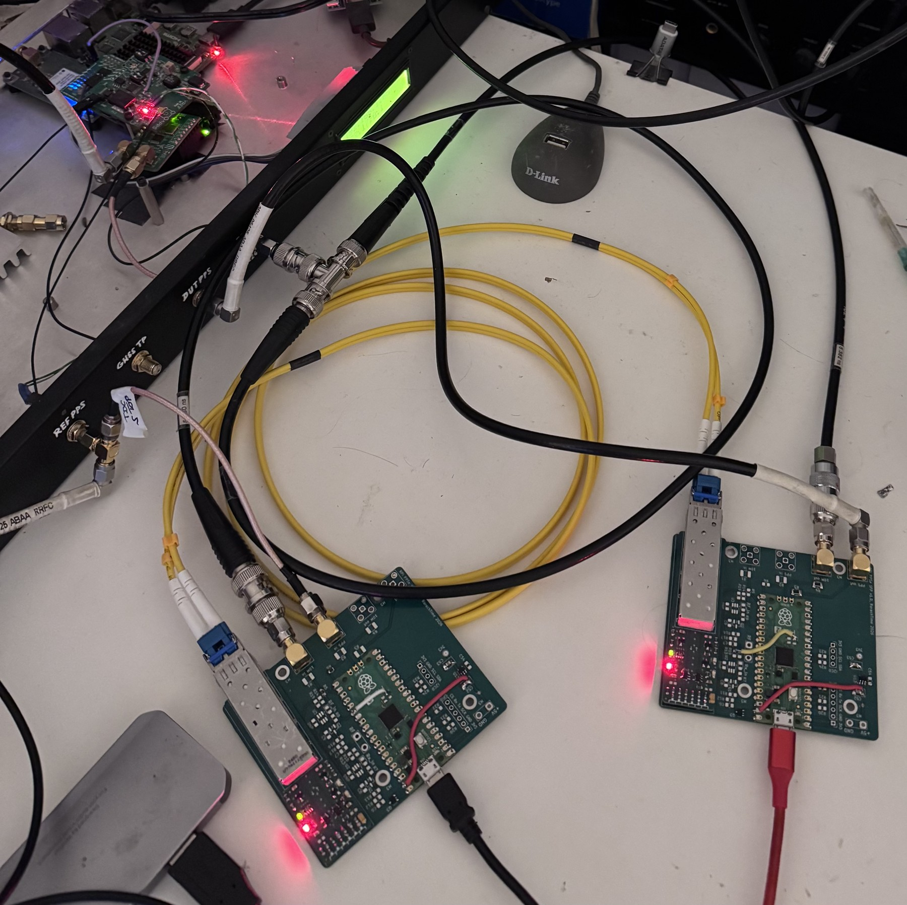
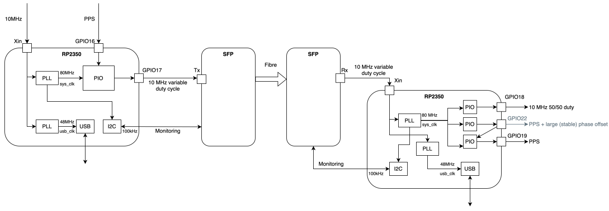
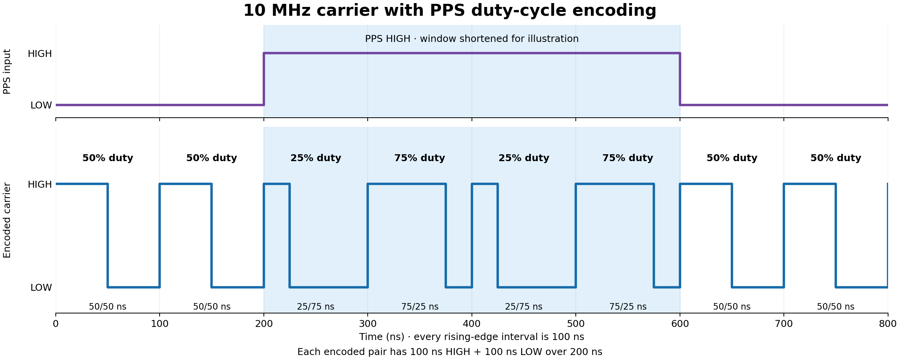
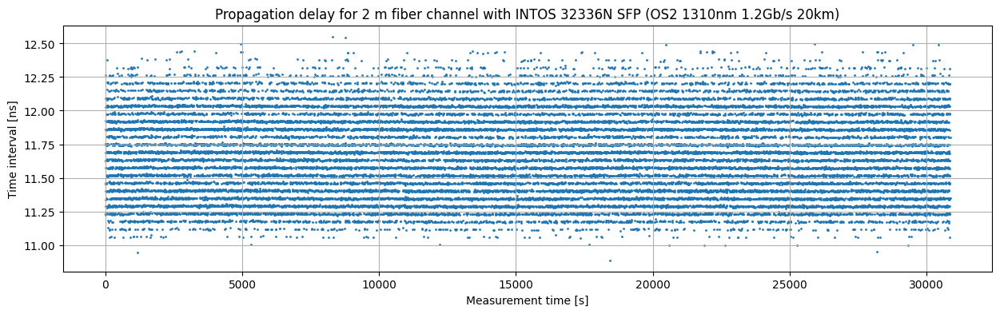
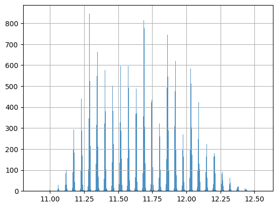
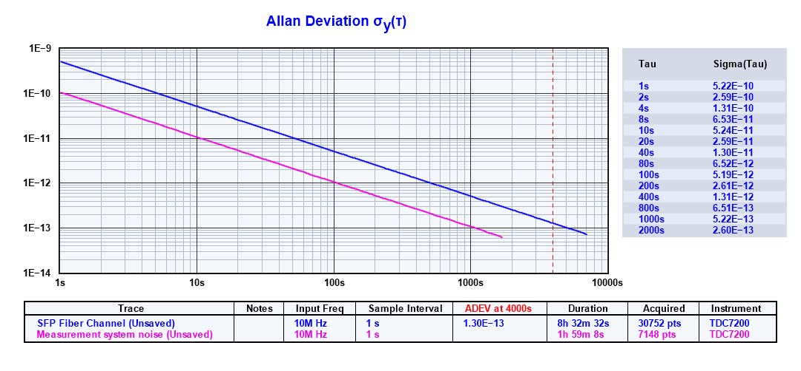
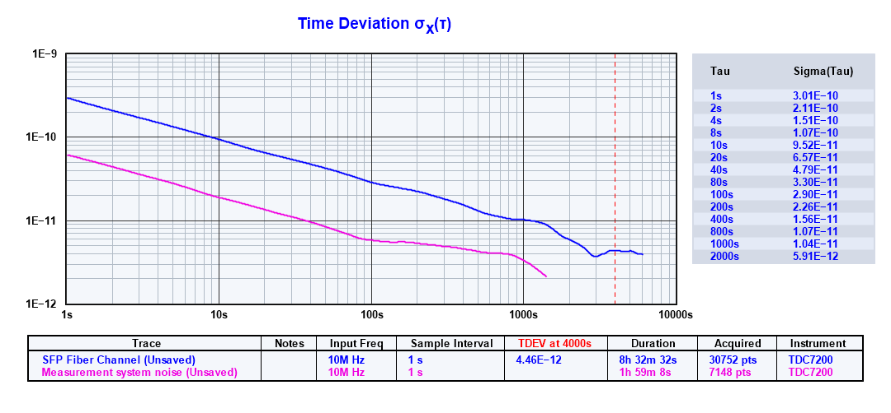
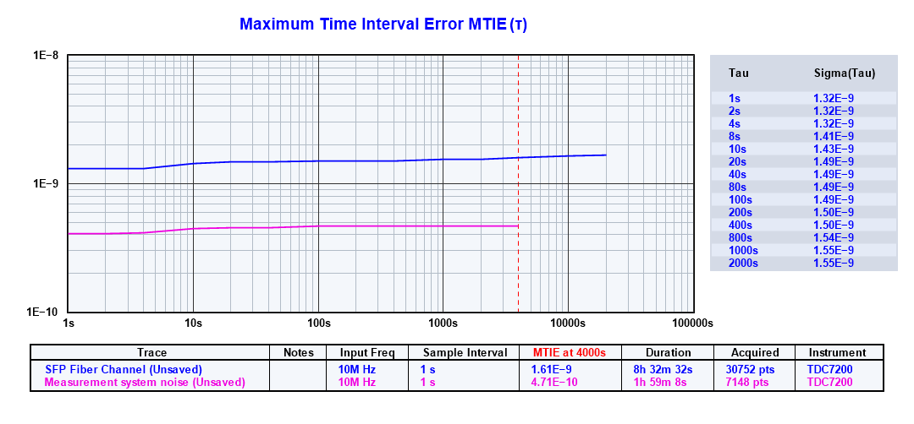

# PicoSFP ePPS — 10 MHz and PPS over optical fiber

**A continuous 10 MHz reference and a PPS timing marker, carried together over one optical channel.** PicoSFP ePPS combines the RP2350's programmable I/O with standard SFP transceivers to build a compact optical timing link. The transmitter embeds PPS in the carrier's duty cycle; the receiver reconstructs a 50% duty-cycle 10 MHz clock and a separate, phase-adjustable PPS output.

The key is a balanced encoding pattern: during PPS, alternating **25% and 75% duty cycles** carry the timing marker while preserving the carrier's 100 ns rising-edge spacing and 50% average duty over each pair. Timing generation and decoding run entirely in PIO, with both boards clocked from the same frequency reference.

Measurements of the **2 m optical channel** show a **300.3 ps standard deviation** across **30,860 samples**, against an estimated measurement-system noise standard deviation of **62.8 ps** ([MIKROE TDC Click board with TDC7200](https://www.mikroe.com/tdc-click)). An approximately 8.5-hour stability measurement adds a view of performance over longer observation intervals, including **1.55 ns MTIE at 20,000 s**.



*The experimental system, built with Pico 2 boards and PMOD SFP adapters.*

## How it works



The design uses two **Raspberry Pi Pico 2 / RP2350** boards and two SFP modules. At the transmitter, the external 10 MHz reference drives XIN and the system PLL generates an 80 MHz PIO clock. The encoder samples the source PPS and sends the duty-modulated carrier to the SFP adapter.

At the receiver, the recovered electrical waveform drives XIN. The receiver derives its own 80 MHz system clock from that reference, detects the encoded marker, and produces separate 10 MHz and PPS outputs. A second PLL supplies the 48 MHz USB clock on each board, allowing SFP diagnostics to remain available over USB serial.

The optical modules used here are **INTOS 32336N**: 1310 nm, single-mode, nominal 1.25 Gb/s NRZ SFPs rated for 20 km. This build and its measurements use a **2 m OS2 patch fiber**. The SFPs carry the encoded clock directly, without an Ethernet framing layer.

## Encoding PPS without interrupting the carrier

The [PIO encoder](ePPS_Tx/picoENC.pio) runs at 80 MHz. Each instruction cycle lasts 12.5 ns, so eight cycles form one 100 ns carrier period.

| PPS input | Carrier pattern | HIGH time | LOW time | Period |
| --- | --- | ---: | ---: | ---: |
| LOW | Repeated 50% duty cycles | 50 ns | 50 ns | 100 ns |
| HIGH, first cycle of pair | 25% duty cycle | 25 ns | 75 ns | 100 ns |
| HIGH, second cycle of pair | 75% duty cycle | 75 ns | 25 ns | 100 ns |



*Ideal digital timing from the encoder instructions. The PPS window is shortened to four carrier periods for clarity; a 10 ms window contains 100,000 periods.*

During PPS HIGH, the sequence repeats **25%, 75%, 25%, 75%, …**. Each pair contains 100 ns HIGH and 100 ns LOW over 200 ns. This keeps the waveform balanced while making the PPS marker distinguishable from the normal carrier.

PPS is sampled at the start of each normal cycle or encoded pair. A pair completes before the next sample. For repeatable timing, use a PPS input synchronous with the frequency reference; an asynchronous edge adds sampling uncertainty.

## Recovering the clock and PPS

The receiver uses three PIO programs:

- **[Clock output](ePPS_Rx/picoSQ.pio):** divides the reference-derived 80 MHz system clock by eight to generate a continuous 10 MHz, 50% duty-cycle output on **GPIO18**.
- **[PPS detector](ePPS_Rx/picoDEC.pio):** samples the received waveform through an XOSC clock mirror on **GPIO21**. The first short HIGH pulse asserts the raw marker on **GPIO22**. The marker clears after 32 consecutive non-short pulses, so the alternating short/long encoding keeps it asserted throughout the PPS window.
- **[PPS phase delay](ePPS_Rx/picoPOFF.pio):** turns the raw marker into a calibrated output pulse on **GPIO19**, using two state machines to handle alternate seconds.

The 10 MHz output follows the received reference through the receiver PLL and PIO. GPIO21 is the receiver's clock-mirror output, sampled internally by the decoder; the external received clock connects to **XIN**.

### Adjusting PPS phase

The settings in [receiver `main.c`](ePPS_Rx/main.c) control the delay and pulse width:

```c
#define PHASE_PRECEDE_CYCLES (80000000u-20u)
#define OUTPUT_WIDTH_CYCLES  (400000u)
```

At 80 MHz, these select a nominal delay of **1 s − 250 ns** and a **5 ms** wide output pulse. Delaying a detected marker by almost one second places its output near the following source PPS edge. The small subtraction provides room to compensate for propagation and detection delay.

Two state machines serve alternate markers because the delay plus pulse width exceeds one second. One skips the first marker at startup; together they produce one output pulse per second after the initial delay.

Calibrate `PHASE_PRECEDE_CYCLES` against the source PPS with the complete link connected. Each count changes the delay by **12.5 ns**; increasing it moves the output later. The value above belongs to this setup and should be adjusted for a different fiber path or hardware.

## Build your own link

The implementation uses **RP2350 / Pico 2** hardware. To reproduce it, start with:

- Two Pico 2 boards, modified for an external XIN clock by desoldering the onboard TCXO
- Two **PMOD SFP adapter boards** from the [VKSDR open-source Pmod project](https://vksdr.com/pmod/), which provide the electrical interfaces used in this build.
- Two suitable SFP modules and a compatible optical patch cable.
- A 10 MHz reference (3.3V), a synchronous PPS source (3.3V), and board/SFP power supplies.
- A time-interval instrument for calibrating the recovered PPS against the source.

**Remove the onboard crystal on each Pico 2 and drive XIN externally.** Connect the source reference to transmitter XIN and the receiving adapter's RXD output to receiver XIN. Connect transmitter GPIO17 to the transmitting adapter's TXD input. Use 3.3 V-compatible signals, a common electrical ground within each local assembly, and a supply sized for the board and SFP load.

The PMOD adapters handle the conversion between single-ended logic and the SFP differential data connections. Their original schematics and board files are available from VKSDR; use them alongside the pin tables below when assembling the hardware.

### Transmitter connections

| Connection | Pico 2 pin / function |
| --- | --- |
| Source 10 MHz reference | XIN |
| Source PPS | GPIO16 |
| Encoded clock → PMOD TXD | GPIO17 |
| PMOD SDA | GPIO10, I2C1 |
| PMOD SCL | GPIO11, I2C1 |
| PMOD DIS / SFP TX_DISABLE | GPIO7 |
| Status LED | Board default LED |

### Receiver connections

| Connection | Pico 2 pin / function |
| --- | --- |
| PMOD RXD → received encoded clock | XIN |
| Clock mirror for internal PIO decoding | GPIO21; leave externally undriven |
| Recovered 10 MHz, 50% duty | GPIO18 |
| Raw decoded PPS marker | GPIO22 |
| Phase-adjusted PPS output | GPIO19 |
| PMOD SDA | GPIO10, I2C1 |
| PMOD SCL | GPIO11, I2C1 |
| PMOD DIS / SFP TX_DISABLE | GPIO7 |
| Status LED | Board default LED |

### Build and flash the firmware

Install the Raspberry Pi Pico SDK and its dependencies, an Arm toolchain, CMake, and Ninja. Set `PICO_SDK_PATH` to the SDK checkout, then build both targets from the repository root:

```sh
export PICO_SDK_PATH=/path/to/pico-sdk

cmake -S ePPS_Tx -B ePPS_Tx/build -G Ninja -DPICO_BOARD=pico2
cmake --build ePPS_Tx/build

cmake -S ePPS_Rx -B ePPS_Rx/build -G Ninja -DPICO_BOARD=pico2
cmake --build ePPS_Rx/build
```

Enter each board's BOOTSEL mode and copy the corresponding UF2 to its USB mass-storage device:

| Board | Build output | Prebuilt firmware |
| --- | --- | --- |
| Transmitter | `ePPS_Tx/build/ePPS_Tx.uf2` | [TX UF2](ePPS_Tx/ePPS_Tx.uf2) |
| Receiver | `ePPS_Rx/build/ePPS_Rx.uf2` | [RX UF2](ePPS_Rx/ePPS_Rx.uf2) |

Rebuild after changing pin assignments or phase calibration.

### Bring up the link

1. Apply the source 10 MHz reference to the transmitter.
2. Power the transmitter and its SFP adapter to establish the optical carrier.
3. Power the receiver with the recovered clock present at XIN.
4. Connect USB for diagnostics, check the recovered 10 MHz and PPS outputs, then calibrate PPS phase against the source.

The custom startup code checks the incoming clock before configuring the PLLs. Missing or rejected clocks produce LED fault indications and reboot retries. The coarse 8–14 MHz acceptance window detects clock presence; the PLL and PIO configuration requires a **10 MHz reference**. The receiver depends on that incoming reference during operation and has no independent holdover mode.

## SFP monitoring

Both boards report module identity and operating conditions over USB serial. I2C1 runs at 100 kHz and reads the SFP identification and diagnostic interfaces at 7-bit addresses **0x50** and **0x51**.

The console reports vendor, part number, revision, serial number, temperature, supply voltage, laser bias current, and transmit/receive optical power. Digital diagnostics support internally calibrated modules with direct A2h access; unsupported calibration or address modes are reported as errors.

PIO handles the timing continuously while the main loop reads diagnostics. On initialization, the driver toggles TX_DISABLE to re-enable the optical transmitter.

## Measured performance

A TDC7200-based measurement system characterizes the **2 m optical channel using INTOS 32336N modules and OS2 fiber**. The delay trace and histogram show the distribution over 30,860 samples:

| Statistic | Optical channel |
| --- | ---: |
| Sample count | 30,860 |
| Mean time interval | 11.662 ns |
| Standard deviation | 300.3 ps |
| 0.1st percentile | 11.057 ns |
| 99.9th percentile | 12.433 ns |
| Central 99.8% span | 1,376.0 ps |





The mean describes the fixed delay of the measured path. The standard deviation and percentile span describe its variation; the central 99.8% span is the interval between the 0.1st and 99.9th percentiles.

### Measurement-system noise

A separate baseline measurement estimates the measurement system's own timing variation:

| Statistic | Measurement-system baseline |
| --- | ---: |
| Standard deviation | 62.8 ps |
| 0.1st percentile | 12.425 ns |
| 99.9th percentile | 12.841 ns |
| Central 99.8% span | 416.0 ps |

The baseline standard deviation is approximately **4.8 times smaller** than the channel measurement's standard deviation. This provides useful context for the channel results while retaining instrument noise in the reported figures. The baseline percentiles refer to the absolute time interval of that separate measurement; they are not an additional fiber delay. No measurement-noise subtraction has been applied.

### Stability over time

The approximately **8.5-hour** run extends the characterization beyond a single delay distribution. ADEV shows fractional-frequency stability versus averaging time and separation of the noise floor, TDEV describes time stability, and MTIE captures the largest time excursion within each observation window.







At an observation interval of **20,000 s**, MTIE is **1.55 ns**. Together, these measurements demonstrate sub-nanosecond standard deviation on the short optical link and characterize its longer-term timing behavior.

The results include the measurement system's contribution and apply to this channel and setup. End-to-end PPS accuracy also depends on encoder/decoder timing and phase calibration; performance over longer fibers, other SFPs, or changing temperatures requires its own measurement.

## Credits

This project was inspired by **[VKSDR's Open Source Pmod Designs](https://vksdr.com/pmod/)** by **[@sam210723](https://vksdr.com/author/sam/)**. The **SFP Pmod boards from that project are used as the SFP adapters in this build**. Their open schematics and PCB designs provided a practical starting point for experimenting with optical clock transport.

## Project files

| Resource | Description |
| --- | --- |
| [`ePPS_Tx/`](ePPS_Tx/) | Transmitter firmware, encoder, clock startup, and SFP driver |
| [`ePPS_Rx/`](ePPS_Rx/) | Receiver firmware, decoder, regenerated clock, and PPS phase adjustment |
| [`System_diagram.svg`](System_diagram.svg) / [draw.io source](System_diagram.drawio) | System architecture and connections |
| [`docs/system_photo.jpg`](docs/system_photo.jpg) | Hardware photograph |
| `measured_TI.png`, `TI_histogram.png` | Optical-channel delay trace and distribution |
| `ADEV.png`, `TDEV.png`, `MTIE.png` | Channel stability measurements |
| [`docs/pps_waveform.svg`](docs/pps_waveform.svg) | Vector encoding waveform |
| [`docs/generate_waveform.py`](docs/generate_waveform.py) | Regenerate the waveform using Python and matplotlib |
| [`IMG_8517.MOV`](IMG_8517.MOV) | Project video |

The firmware, connection tables, and editable diagram are intended as a starting point for building and measuring your own link. Start with a short fiber, verify the recovered clock, and calibrate PPS phase before extending the setup.
